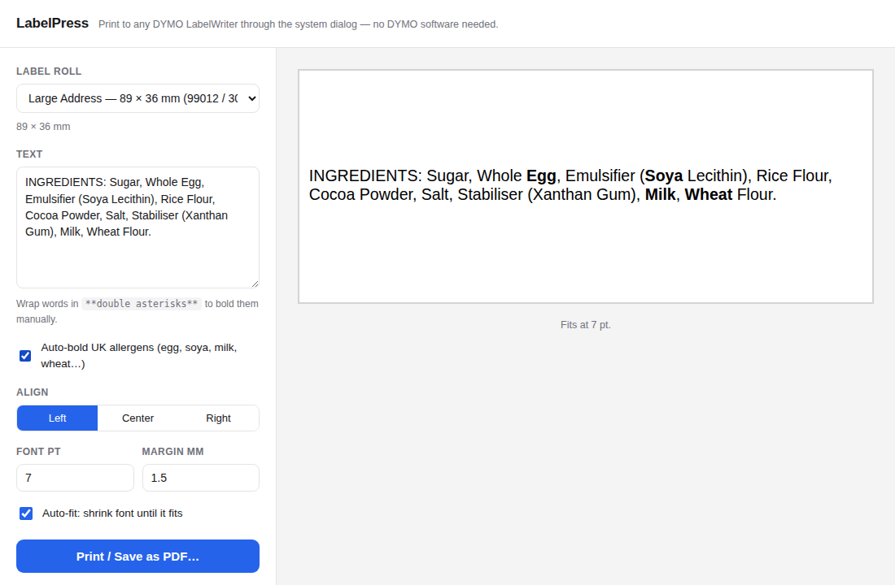

# LabelPress

A tiny, dependency-free label maker for DYMO LabelWriter printers — including old ones like the **LabelWriter 400 Turbo** that DYMO's current software no longer supports.

It's a single HTML file. Open it in a browser, type your text, pick a roll size, and print. The printer talks to your Mac/PC through the normal system print driver (CUPS on macOS), so you don't need any DYMO application at all.

## Why this exists

DYMO Label v8 is a 32-bit-era app that breaks on recent macOS and Apple Silicon, and DYMO Connect dropped support for older printers like the 400 Turbo. But the printer itself still works fine through the OS print system. LabelPress replaces only the dead part — the label designer — and hands the print job to the driver you already have.

## Features

- Runs entirely in the browser, offline, from one file. No install, no build step, no dependencies.
- Roll presets for common DYMO labels (99010, 99012/30321, 99014, 11354, 11356) plus a custom W×H.
- Exact-size output — the print page is generated at the label's real millimetre dimensions via CSS `@page`, so it prints 1:1 with no scaling.
- **Auto-fit**: shrinks the font until the text fits the label.
- **Allergen bolding** for UK/EU food labels — auto-bolds the 14 FSA allergens (egg, soya, milk, wheat, nuts…), or bold any words yourself with `**double asterisks**`.
- Left / centre / right alignment, adjustable margin.
- Remembers your last label between sessions.
- **Direct USB printing (experimental)** — prints straight to the printer over WebUSB, with no OS print driver at all (see below).

## Direct USB printing (experimental)

The **Direct USB** panel talks to the LabelWriter directly from the browser over WebUSB: it rasterises the label to a 300 dpi 1-bit bitmap and streams the LabelWriter raster protocol to the printer's bulk endpoint. No CUPS queue, no DYMO helper, no driver — which means it keeps working even on an OS that has dropped support for the printer's driver (e.g. macOS releases without Rosetta / classic CUPS drivers).

Chrome or Edge only (WebUSB). To use it: click **Connect printer**, pick your LabelWriter, then **Print via USB**. The `Rotate 90°` toggle orients the bitmap along the feed direction (on for address/ingredient labels).

Status: **verified end to end on a LabelWriter 400 Turbo (macOS 27, Apple Silicon)** — prints a correct label with no driver installed at all. The command constants live at the top of the WebUSB block in `index.html`; other LabelWriter models may need a small tweak.

Troubleshooting:
- **Printer not in the picker** — reseat its USB / dock connection so the OS re-enumerates it, then reconnect.
- **"claim"/"busy" error on connect** — the OS print queue is holding the device; pause or remove the DYMO queue in your printer settings, replug, and reconnect.

## Use it

Open `index.html` in Chrome, Edge, or Safari. Then:

1. Choose your **label roll** (or Custom and enter the size in mm).
2. Type or paste your **text**. Use blank/new lines for address labels; long ingredient lists wrap automatically.
3. Optional: tick **Auto-bold UK allergens**, or wrap words in `**asterisks**` to bold them.
4. Leave **Auto-fit** on, or untick it and set an exact font size.
5. Click **Print / Save as PDF…**, choose your DYMO printer, and print at **100% / Actual size** (turn off "Scale to fit").

### Print settings that matter

- Scale: **100%** / Actual size — never "Fit to page".
- Paper size: pick the matching DYMO label. On macOS the 400 Turbo's 36×89 label is listed as **30321** (US part no.), the same label as the European **99012**. If your exact size isn't listed, use the browser's custom paper size.

## Compatibility note

LabelPress depends on your OS still having a working print driver for the printer. For the 400 Turbo that driver is currently provided by CUPS/the system. If a future OS release removes it, no design app can bring the printer back — that's a hardware-support limit, not something this tool controls.

## Contributing

It's one file — `index.html`. Roll presets live in the `ROLLS` array and the allergen list in `ALLERGENS`, both near the top of the `<script>`. PRs welcome.

## License

MIT — see [LICENSE](LICENSE).
